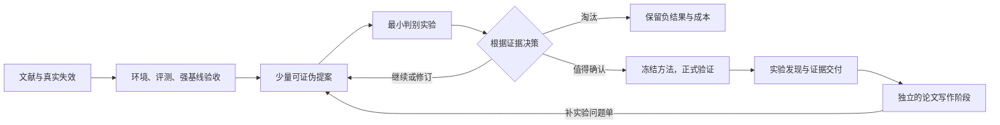

# Agent Research Lab

让 Agent 围绕真实问题**提出可检验的创新、运行可信实验、根据证据决定下一步**，最终交付可复现研究与论文材料。

本项目重点实现素材⑤“先环境、评测与强基线，再放开探索”，结合②的材料拆解与假设反驳、④的模块功能分析，以及后来核对的 Vuk 选题与实验系列。适用于**实验型人工智能研究**，单个能读写文件和执行命令的 Agent 即可使用。

**可以用于不同 AI 方向，不局限于时间序列或 Muon。** LLM、优化器、视觉、多模态、时序、RL 和推理系统可共用研究循环，分别接入自己的数据、训练代码、指标与对照。[适用范围与接入指南](skills/research-experiments/references/ai-domains.md) 列出具体差别；[优化器示例](examples/optimizer.md) 展示从 Muon 相关问题开始的方法。当前框架不覆盖纯理论证明等所有类型的论文。

**实验与写作分开。** `research-experiments` 管实验研究主循环，按需调用 `research-ideation` 讨论点子与查新；`research-writing` 仅在论文任务中使用①③的写作建议。写作技能不加载到实验阶段，不能改变指标、对照、数据或负结果。写作发现证据缺口时，以问题单返回实验流程。

**导师角色已接入。** [research-supervisor](skills/research-supervisor/SKILL.md) 参考 HKUSTDial/Supervisor-Skills，负责研究价值、证据缺口与下一步资源投入的判断；具体训练与验证仍交给实验流程。

## 核心：围绕创新反复跑实验



Agent 每轮需要回答：**哪个基线在哪里失效，为什么，改哪一步，什么实验能推翻解释，结果说明什么，下一步还值不值得跑。** 所有尝试保留，不把“必须赢”作为循环终点。

优先阅读：[选题与点子辩论](skills/research-ideation/SKILL.md)、[创新与候选决策](skills/research-experiments/references/innovation.md)、[实验执行手册](skills/research-experiments/references/execution.md)。点子可以早期讨论，正式候选搜索仍要通过基线与评测验收。

视频逐项对应见 [来源说明](skills/research-paper/references/sources.md) 和 [Vuk 系列核查](skills/research-paper/references/vuk-series.md)：本轮全文转写核对 7 条视频并抽查画面，另使用用户提供的⑤逐字稿；目录中只有元数据的条目明确标注，未冒充已看完。

## 导师怎样参与研究

| 职责 | 主要任务 | 交付 |
| --- | --- | --- |
| research-supervisor | 方向取舍、扩大实验前判断、结果冲突或停滞复盘 | 有依据的建议、最优先缺口、下一项具体实验与成本 |
| research-ideation | 拆解点子、竞争解释、真实查新 | 可证伪草案与最小判别实验 |
| research-experiments | 基线、评测、实现、运行、分析与确认 | 真实运行、证据与 continue/revise/drop/promote 决策 |
| research-writing | 基于已交付证据写作和修订 | 与证据相称的论文材料；缺证据则开实验问题单 |

research-paper 负责按任务路由。默认一个 Agent 顺序承担这些职责，角色自查不冒充独立复核。导师在关键决策点介入，不给每次短测增加审批，也不能凭“看好这个点子”跳过验收或扩大预算。指导完成后，按现有授权继续具体工作。

上游的研究价值与文献核查方法经过实验适配；其稿件评分、叙事要求、固定周工时／GPU 门槛没有整体启用。导师适配模块保留 CC BY-NC-SA 4.0 署名许可，详见 [采用范围与改动](skills/research-supervisor/references/attribution.md)。

## 直接开始

需要 Python 3.10+，框架无第三方 Python 依赖，无需模型 API Key。模型由你正在使用的 Agent 提供；训练依赖由具体研究环境管理。本地执行器使用 Linux/macOS 的 POSIX 进程组，其他系统可使用已有训练器并导入记录。

在本仓库目录执行：

```bash
python3 scripts/research.py init \
  --project projects/my-first-study \
  --topic "填写你的研究方向"

cd projects/my-first-study
python3 tools/research.py status --project .
```

把这个新工作目录交给 Agent，粘贴：

```text
读取 AGENTS.md 和 .agents/skills/research-experiments/SKILL.md，开始这个研究项目。
先根据当前材料明确研究问题、数据条件和资源预算，建立“问题—方法—证据”文献表。
先跑通环境、评测和强基线，通过验收后提出少量可证伪创新，逐轮做最小判别实验。
每轮保存真实运行，决定继续、修订、淘汰或正式验证。实验阶段不要加载写作技能。
沿用我已经给出的资源与动作授权。缺少必要信息时先完成不依赖它的工作，再集中询问。
推进当前阶段，保存真实文件和证据，结束时更新 STATE.md。
```

模板中的 GPU 预算为 0，CPU 运行总时长上限为 2 小时；根据真实已有授权填写 `project.json`。初始化只建立工作目录。它带有实验、选题讨论、导师、写作、调度五个独立技能，以及任务、提案、决策、导师复盘、评测验收、事前预测、领域接入和轮次报告模板。

实际训练前需要确定具体问题、数据／代码和机器预算。暂时只有大方向也能先查文献、读代码和讨论假设；框架不附带某个课题的训练数据或预设创新答案。

## 一条完整研究链

| 阶段 | Agent 要回答的问题 | 主要产出 | 进入下一阶段的条件 |
| --- | --- | --- | --- |
| scope | 问题是什么，值得解决吗，能付出多少成本？ | project.json | 问题、贡献类型、限制和预算明确 |
| literature | 已有哪些解释与证据，最接近的工作是什么？ | literature.json | 有检索记录、原始来源和综合判断 |
| hypothesis | 初始失效判断是什么，怎样验证？ | hypothesis.json | 初始预测、替代解释、近邻与证据成本明确 |
| protocol | 怎样公平、可复现地检验假设？ | protocol.json、环境与切分文件 | 用 freeze 固化协议 |
| pilot | 环境和基线是否可信，哪些候选值得扩大？ | pilot.json、ideas、短运行与决策 | 先验收基线及评测分辨能力，再探索；候选通过机制和可行性判断 |
| experiments | 冻结设置下的结论是否稳定？ | 正式运行、summary、analysis | 选定的正式网格完成、预算可核对、审查通过 |
| paper | 每个重要主张的证据和边界是什么？ | claims.json、正文、参考文献 | 主张映射到正式实验与真实文献 |
| submission | 当前 venue 的具体要求是否满足？ | PDF、复现材料、submission.json | 逐项核对当年官方要求与最终成品 |

`check` 累计检查至指定阶段；`advance` 只在当前阶段检查通过后推进。首次冻结可以只有 baselines、candidates=[]；初始假设用于诊断，不要求提前发明方法。探索、修订与确认会形成多个协议版本，淘汰候选保留在历史记录，正式网格只包含本轮选定方法及必要对照。工具能检查结构、覆盖率和文件一致性，科学意义、检索充分性和实现正确性仍需实际判断。

## 工具能做什么

```bash
# 在初始化后的研究工作目录中
python3 tools/research.py check --project . --stage hypothesis
python3 tools/research.py advance --project .

# 完成协议、环境、切分、评测脚本后
python3 tools/research.py freeze --project .

# 执行任务或顺序计划，自动保存日志、指标、耗时和失败记录
python3 tools/research.py execute --project . --file inputs/run-001.json --dry-run
python3 tools/research.py execute --project . --file inputs/run-001.json

# 环境和基线验收后登记创新提案，实际实验后登记决策
python3 tools/research.py propose --project . --file inputs/idea-001.json
python3 tools/research.py decide --project . --file inputs/decision-001.json
python3 tools/research.py next --project .

# 使用现有集群/训练器时，登记已有运行及其证据
python3 tools/research.py record --project . --file artifacts/run-input.json
python3 tools/research.py review --project . --file artifacts/review-input.json

# 只汇总当前协议下 completed 的 confirmatory 运行
python3 tools/research.py summarize --project .
python3 tools/research.py check --project . --stage experiments

# 需要改变假设、评测、切分、环境或预算时，建立新版本
python3 tools/research.py freeze --project . --reason "说明变更及独立确认计划"
```

- **协议版本**：冻结假设、预算、指标、种子、数据切分、环境和评测脚本的 SHA-256；变更后旧结果保留，当前正式汇总自动排除它们。
- **运行证据**：保存命令、代码快照、环境、日志、原始指标和文件哈希。失败运行也记录消耗。
- **实际执行**：单任务或顺序计划、预算预检、超时终止进程组、失败即停。候选需基线验收，正式执行需该模型 pilot 和已冻结代码/配置。
- **评测验收**：`evaluator_sensitivity` 必须有实际对照证据，不能用 na 跳过；模型能运行、指标能算不足以通过验收。
- **事前预测**：job 可指定 `intent_file`，启动前归档预测、竞争解释和反证条件，随后和运行证据一起校验，便于核对意外结果。
- **创新决策**：提案包含机制、预测、反证、近邻对照、最小实验；决策引用真实运行，五秒 smoke 不能作为晋级正式验证的依据。
- **重复与污染检查**：同一协议下同模型、数据集和种子的正式完成记录不能重复；调试和调参成绩不能进入正式汇总。
- **有限审查**：按 pilot / experiments / paper 登记问题；新增运行或材料变化使相关审查过期。旧的重要问题不会因为新一轮省略而消失。
- **主张账本**：机制主张需要消融运行；正文引用必须对应已登记文献和 BibTeX key。
- **交接恢复**：机器状态保存在 JSON，阶段结论与下一步保存在 STATE.md，取舍保存在 DECISIONS.md。

运行与审查的完整字段、退出码和约束见 [记录格式](skills/research-paper/references/records.md)。`execute` 运行你或 Agent 实现的训练程序，`record` 导入外部结果；执行器不内置领域模型，也不调用模型 API。预算基于声明资源和实际耗时，不能控制框架外的进程。写入命令顺序执行，勿并发写同一工作目录。文件哈希用于发现意外改动，不提供防恶意篡改的可信认证。

## Agent 手册与任务提示词

- [实验技能入口](skills/research-experiments/SKILL.md)：实验阶段默认入口，不加载写作规则。
- [选题与创新讨论](skills/research-ideation/SKILL.md)：竞争解释、真实查新、证据评分、最小判别实验。
- [科研导师](skills/research-supervisor/SKILL.md)：判断课题是否值得继续、证据还缺什么、下一笔资源用在哪里；[导师提示词](prompts/supervise.md) 可直接复制使用。
- [AI 方向接入](skills/research-experiments/references/ai-domains.md)、[评测有效性](skills/research-experiments/references/evaluator-validation.md)、[探索与尺度晋级](skills/research-experiments/references/search-and-scale.md)：怎样接训练代码、验证评测和分配下一轮预算。
- [找问题](skills/research-experiments/references/workflow.md)、[创新与候选决策](skills/research-experiments/references/innovation.md)：从文献和失效证据形成最小判别实验。
- [实验设计](skills/research-experiments/references/experiments.md)、[运行与恢复](skills/research-experiments/references/execution.md)：基线、分层验证、执行器、预算和中断恢复。
- [独立写作技能](skills/research-writing/SKILL.md)：证据交付后使用；对 formal-doc-revision 作科研适配，保留来源与许可。
- [项目调度入口](skills/research-paper/SKILL.md)：恢复状态和按阶段路由，不混用两类技能。
- [启动](prompts/start.md)、[点子辩论](prompts/ideate.md)、[创新轮次](prompts/experiment-round.md)、[实验审查](prompts/review.md)、[论文修订](prompts/write.md)、[恢复研究](prompts/resume.md)：可直接复制给 Agent。
- [时间序列选题示例](examples/time-series.md)：展示如何拆问题；只包含待验证计划，没有虚构成绩。
- [优化器选题示例](examples/optimizer.md)：从 Muon 机制问题接入实验，未预设新颖性或结果。
- [材料来源与采用边界](skills/research-paper/references/sources.md)：哪些启发被采用，哪些说法需要纠正。

可以在 Codex、Claude Code 或能读写本地文件的其他 Agent 中使用。新目录带有 AGENTS.md、CLAUDE.md 和完整技能文件。其他客户端可直接把技能路径放进首条任务，不依赖它是否自动发现技能。

旧工作目录更新工具后，需补齐新增的 evaluator_sensitivity 检查与 pilot 复审，具体见 [迁移说明](skills/research-experiments/references/evaluator-validation.md)。不要用初始化命令覆盖已有研究。

## 验证框架

```bash
python3 -m unittest discover -s tests -v
python3 scripts/research.py --help
```

测试包含真实临时子进程的成功、失败、超时及子进程终止，预算预检、基线准入、候选晋级、协议失效、证据变更、负结果和投稿材料链。测试产物只存在于临时目录，不作为科研成绩。研究本身还需要真实数据、算力、领域判断及目标 venue 的最新规范；本项目不承诺录用，也不会自动提交论文。

## 感谢
https://github.com/hkustdial/supervisor-skills
